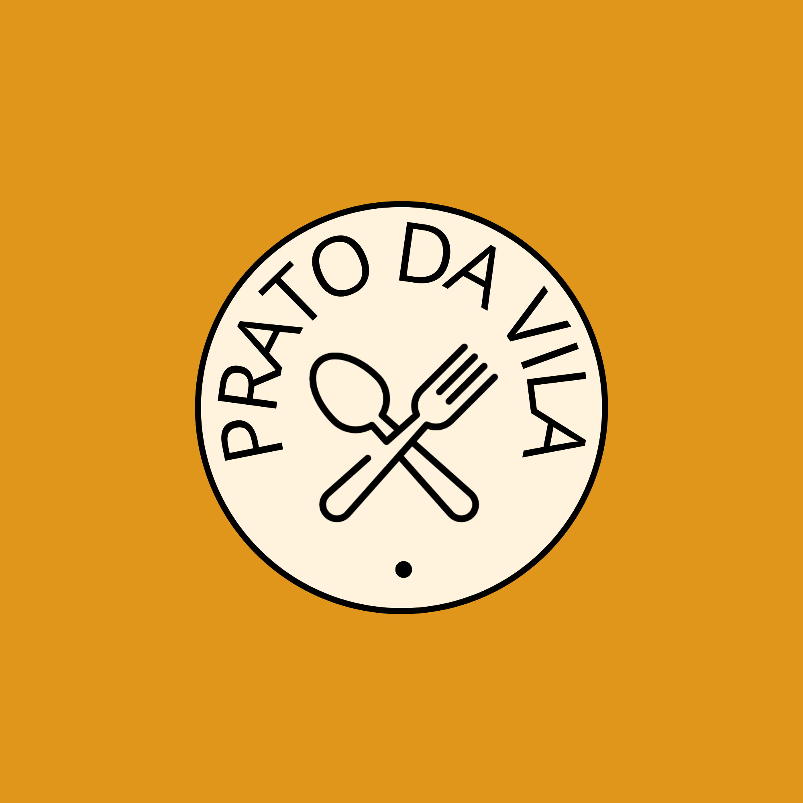
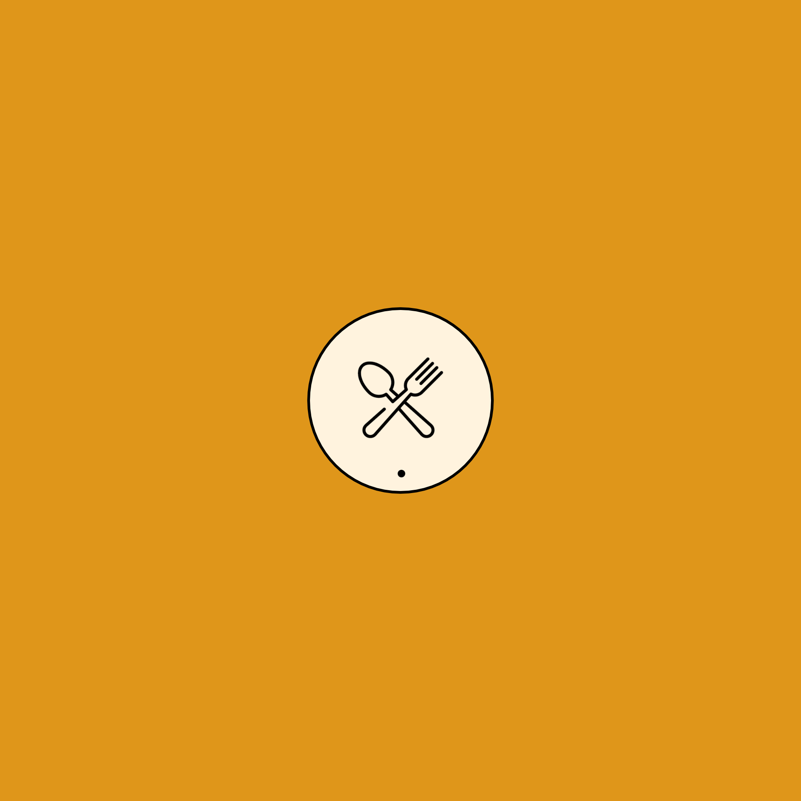

# Prato da Vila
Repositório criado para o projeto final da disciplina ARQDMO1, Prato da Vila. O aplicativo é uma alternativa às grandes redes de delivery, que cobram taxas abusivas de comerciantes locais, e oferece um cardápio digital simples para pequenos estabelecimentos do setor alimentício.

## Descrição
O Prato da Vila permite que o pequeno comerciante monte e mantenha o cardápio do seu estabelecimento direto no celular, sem depender de plataformas pagas, e divulgue seus pratos para os clientes pelos aplicativos que eles já usam (WhatsApp, e-mail etc.).

### Por que este aplicativo é importante?
Pequenos estabelecimentos chegam a pagar taxas altas por pedido nas grandes plataformas de delivery. Um cardápio próprio, gratuito e fácil de compartilhar dá a esses comerciantes um canal direto com o cliente, sem intermediários.

### Funcionalidades
**Listagem de pratos:** cardápio com imagem e nome de cada prato (RecyclerView).

**Detalhes do prato:** ao tocar em um item, abre uma tela com imagem, nome, descrição e preço.

**Compartilhar prato:** envia as informações do prato para outro aplicativo (WhatsApp, e-mail…) usando Intent implícita.

**Cadastro de pratos:** inserir, editar e excluir pratos, escolhendo uma imagem da galeria.

**Persistência local:** os pratos ficam salvos no aparelho e continuam disponíveis após fechar o app.

**Idiomas:** português (pt-BR) e inglês, conforme o idioma do sistema.

**Tema claro e escuro:** segue a configuração do sistema.

# Capturas de tela, imagem ou vídeo do projeto
Pendente (serão adicionadas ao final do desenvolvimento).

# Status do projeto
Em desenvolvimento.

- [x] Etapa 0 – Estrutura inicial do projeto
- [x] Etapa 1 – Identidade visual (cores, temas claro/escuro, logo) e textos em pt-BR/inglês
- [-] Etapa 2 – Banco de dados local com Room
- [ ] Etapa 3 – Listagem de pratos com RecyclerView
- [ ] Etapa 4 – Tela de detalhes e compartilhamento (Intent implícita)
- [ ] Etapa 5 – Cadastro: inserir, editar e excluir pratos com imagem
- [ ] Etapa 6 – Testes, revisão e documentação final

# Tecnologias utilizadas
- Kotlin, Android Studio (layouts em XML)
- minSdk 33 (Android 13) / targetSdk 37
- ViewBinding
- ConstraintLayout
- RecyclerView
- Room + KSP (persistência local; imagem salva como URI em texto)
- Material 3 (tema claro/escuro seguindo o sistema)
- Internacionalização: inglês (padrão) e português (pt-BR)

### Organização do código
```
br.edu.ifsp.pratodavila
    ui -> telas (Activities)
    model -> classes de dados
    data -> banco de dados Room (entidade, DAO, database)
    adapter -> adapter da RecyclerView
```

## Design
(Em desenvolvimento, ajustes pendentes)
# Paleta de cores

# Logo

# Logo alternativo

# Ícones




# Instruções de instalação e uso
Pendente.

# Aprendizado e Desafios
(Em desenvolvimento)

# Melhorias futuras
Funcionalidades que ficaram fora do escopo desta versão:
- Perfil de cliente com carrinho de compras e pedido.
- Envio de pedidos para impressora do comerciante.
- Solicitação de entrega.
- Avaliação do estabelecimento pelos clientes.

# Licença
(Em desenvolvimento, provavelmente licença MIT)

# Desenvolvedor
Projeto feito por Rodrigo Moro Taveira, estudante do curso de ADS do IFSP câmpus Araraquara

# Contato
rodrigo.taveira@aluno.ifsp.edu.br
